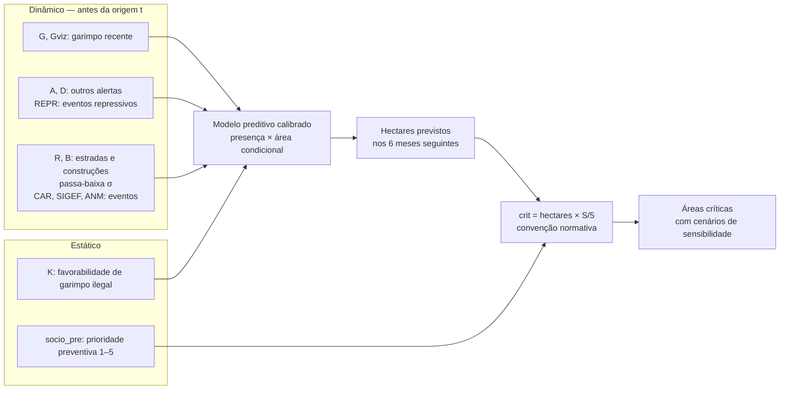

# Modelo integrado: definição de áreas críticas de garimpo

**Especificação de 6 de outubro de 2026. Código: `integrado_v1_20261006`.**

Este protocolo reúne as três frentes já especificadas: o **modelo estático** (K e prioridade socioambiental preventiva), a **pressão antrópica recente** e a **transformação territorial recente**. Ele também define a regra que as combina em **áreas críticas**. O processamento é feito por `modelo_integrado_console.py`, no console Python do QGIS. Nenhum resultado sobre os dados reais foi calculado neste documento. Os números da seção 13 vêm de dados sintéticos e servem só para verificar o código.

## 1. O que foi juntado

| Bloco das figuras | Entra no modelo como | Estado |
|---|---|---|
| Favorabilidade de garimpos ilegais (potencial remanescente, máscara de mineração legal) | Covariável **K**, por sub-bacia, com coeficiente estimado | Implementado; K já calculado é lido, não recalculado |
| Risco socioambiental | `socio_pre` (1–5), peso **normativo** S/5 na camada de decisão | Implementado; vem de `risco_socioambiental_console_v2.py` |
| Alertas de alteração territorial | **G** (garimpo na sub-bacia), **Gviz** (garimpo nas vizinhas), **A** (Acesso), **D** (outros desmatamentos) | Implementado |
| Eventos repressivos IBAMA/ICMBio | **REPR**, coeficiente de sinal livre | Opcional; entra só se configurado |
| Estradas e edificações | **R** e **B**, com passa-baixa gaussiano | Implementado, condicionado à presença das classes |
| Estrutura fundiária (CAR/SIGEF) e situação minerária (ANM) | **CAR**, **SIGEF**, **ANM**: contagem de eventos datados | Opcional; pendente onde não houver histórico |

A camada de alertas e as classes são as identificadas por `transformacao_territorial_diagnostico.py`. Esse diagnóstico deve ser executado antes. Ele informa se `dat_public` é a publicação original, quais classes existem e se há fontes cadastrais com eventos datados.

## 2. Arquitetura revisada

A figura original combinava os blocos com operações fixas: (−) entre alertas e eventos repressivos e (x) entre os modelos estático e dinâmico. Os protocolos anteriores já haviam estabelecido que essas operações não estão validadas. Elas foram substituídas por coeficientes estimados na parte preditiva. Só a camada de decisão mantém uma multiplicação fixa, declarada como convenção.

Na escala logit, somar K aos termos dinâmicos equivale a multiplicar chances. Essa é a versão **calibrada** do (x) da figura: o peso relativo de cada termo é estimado, e não imposto.

## 3. Pergunta, unidade e desfecho

**Pergunta preditiva:** quantos hectares de alertas de garimpo cada sub-bacia deve registrar nos seis meses seguintes a uma origem mensal t, dado o que era conhecido antes de t?

**Pergunta de decisão:** entre as sub-bacias com maior expectativa de novo garimpo, quais proteger primeiro segundo a orientação preventiva adotada?

- **Unidade:** sub-bacias HydroBASINS nível 12, uma feição por `HYBAS_ID`. É a mesma unidade da métrica operacional e da camada socioambiental.
- **Desfecho:** área de alertas da classe garimpo detectados nos meses t a t+5, intersectada com a sub-bacia. Conta a data de detecção, não a de publicação.
- **Presença:** desfecho > 0.

A validação anterior foi feita na grade de 250 m. Aqui, G e a vizinhança são **versões por sub-bacia** e não reproduzem a convolução de grade usada em G. Os resultados deste modelo não substituem os da validação de grade. Eles produzem a ordenação operacional na unidade de decisão.

## 4. Regra temporal

- Na origem t, um alerta só entra como preditor se foi **detectado** em [t−L, t−1] e estava **disponível** antes de t. Com `DISPONIBILIDADE = 'publicacao'`, a disponibilidade é a data mais tardia entre detecção e publicação. Um alerta sem publicação válida entra apenas no desfecho.
- Com `DISPONIBILIDADE = 'deteccao'`, o resultado deve ser descrito como **retrospectivo por data de detecção**.
- Se `dat_public` for a data da versão atual, e não a da publicação original, a regra fica conservadora: perde informação, mas não vaza informação futura. O relatório registra a distribuição dos atrasos de publicação em meses.
- Origens sem L meses de histórico dentro da cobertura, ou sem os H meses de desfecho observados, são excluídas de **todos** os modelos. Com cobertura a partir de set/2020 e L = 6, as primeiras origens válidas são de mar/2021.
- Eventos CAR/SIGEF/ANM/REPR seguem a mesma regra quando têm campo de disponibilidade. Sem ele, usa-se a data do evento e o relatório marca o uso como retrospectivo.
- Zeros de alertas pressupõem que o produto cobriu todo o domínio em todo o período. Lacunas de monitoramento precisam ser excluídas antes, no filtro da camada.

Períodos de origem mantidos: ajuste interno jan/2021–jun/2022, validação interna jan–jun/2023, ajuste final jan/2021–jun/2023 e teste histórico jan/2024–jun/2025, com desfechos observados até nov/2025.

## 5. Preditores

| Termo | Definição (janela L = 6 meses) | Observação |
|---|---|---|
| `log_area` | log da área elipsoidal da sub-bacia (km²) | Controla o tamanho da unidade |
| `K` | Média de K na sub-bacia, sem transformação ou em logit | K deve excluir população e mercúrio |
| `G` | log1p dos hectares de garimpo detectados e disponíveis | Histórico recente na própria sub-bacia |
| `Gviz` | log1p da soma de G nas sub-bacias que se tocam | Versão por sub-bacia da propagação espacial |
| `A` | log1p dos hectares de Acesso | Pressão antrópica |
| `D` | log1p dos hectares de outros desmatamentos e degradação | Classes listadas no relatório |
| `REPR` | log1p do número de eventos repressivos | Sinal livre; não é subtração fixa |
| `R`, `B` | log1p dos hectares de estradas e construções após passa-baixa σ | Área detectada, não comprimento |
| `CAR`, `SIGEF`, `ANM` | log1p do número de eventos datados | Área integral da parcela não é usada |

Todos os termos são padronizados no conjunto de ajuste. Termos sem variação são descartados e listados. Classes de alerta sem grupo são ignoradas e listadas.

## 6. Passa-baixa na unidade sub-bacia

O protocolo de transformação territorial exige suavização espacial de estradas e construções. Na sub-bacia, a soma do campo suavizado tem forma exata:

\[
\sum_{x\in b}(G_\sigma * z)(x) \;=\; \sum_{D} m_D\; \Pr\!\left(D+\varepsilon \in b\right),\qquad \varepsilon\sim N(0,\sigma^2 I).
\]

Isto é, cada detecção D, de massa m_D, é distribuída entre as sub-bacias conforme a probabilidade de que um deslocamento gaussiano isotrópico, com desvio-padrão σ **por eixo**, a coloque em cada uma.

- Detecções a mais de 4σ de qualquer divisa permanecem inteiras na sub-bacia, como na interseção exata.
- As demais são amostradas em até `PONTOS_POR_DETECCAO` pontos, deslocados em uma quadratura de Gauss–Hermite 5×5.
- A massa que cairia fora do domínio é **renormalizada** entre as sub-bacias do domínio, de forma análoga a Gσ(v·z)/Gσ(v). O relatório registra essa massa.
- σ é escolhido entre 125, 250 e 500 m na validação interna. σ = 0, a interseção exata, é calculado apenas como **diagnóstico**.

Em sub-bacias de dezenas de km², o efeito de σ ≤ 500 m se limita às divisas. É esperado que a escolha de σ altere pouco o resultado.

## 7. Modelo preditivo

Modelo em duas partes, ajustado em painéis sub-bacia × origem:

\[
\operatorname{logit}\Pr(Y_{b}(t)>0)=\alpha+\boldsymbol\beta^\top \mathbf x_b(t),
\qquad
\mathbb E[Y_b(t)\mid Y_b(t)>0]=\exp(\gamma+\boldsymbol\delta^\top \mathbf x_b(t)),
\]

\[
\widehat{\mathrm{ha}}_b(t)=\hat p_b(t)\,\hat\mu_b(t).
\]

- A área condicional é **lognormal com correção de Duan** ou **gama com ligação log**. A família é escolhida na validação interna.
- Penalização ridge leve (λ = 1) nas covariáveis padronizadas evita separação; o intercepto não é penalizado.
- Erros-padrão são **robustos por bloco espacial** (quadrados de 100 km) e cobrem a dependência entre origens sobrepostas da mesma região.
- Os coeficientes são associações preditivas, não efeitos causais.
- A média condicional é limitada a 10 vezes o maior valor visto no ajuste, como salvaguarda contra extrapolação.

## 8. Especificações, seleção e teste

Especificações aninhadas, fixadas antes de olhar os dados:

| Nome | Termos |
|---|---|
| régua | Hectares de garimpo do semestre anterior, desempatados por K (sem modelo) |
| K | log_area + K |
| **KG (referência)** | + G + Gviz |
| KG+P | + A + D + REPR |
| KG+RB | + R + B (primeiro confronto do protocolo territorial) |
| integrado | todos os termos disponíveis |

Termos indisponíveis são removidos. Especificações que ficam idênticas a uma anterior são descartadas.

**Critério:** captura agregada de hectares nas 10% sub-bacias priorizadas (Σ capturado / Σ observado, somando as origens).

**Seleção, só com ajuste e validação internos:**

1. Transformação de K e família da área, sobre KG.
2. σ do passa-baixa, sobre KG+RB.
3. Especificação: escolhe-se a **mais simples** cuja captura fique a até 0,5 p.p. da melhor. Um ganho nulo leva ao modelo mais simples.

A validação interna tem apenas seis origens. O critério é ruidoso e a tolerância existe por isso.

**Teste histórico (exploratório):** todas as especificações são reajustadas no ajuste final e avaliadas em jan/2024–jun/2025. São reportados:

- captura em 1, 5 e 10%, agregada e média por origem;
- fração da área total ocupada pelas sub-bacias selecionadas;
- AUC da presença e Brier;
- razão entre hectares previstos e observados;
- calibração por decil;
- bootstrap espacial pareado por blocos, com 500 réplicas, das diferenças de captura de cada especificação contra KG e contra a régua.

Esse período já foi examinado em rodadas anteriores. Os resultados **não** reabrem a seleção.

**Previsão operacional:** a especificação escolhida é reajustada com todas as origens de desfecho completo (mar/2021–jun/2025) e aplicada à origem dez/2025, para o horizonte dez/2025–mai/2026. Com `REAJUSTE_OPERACIONAL = 'ajuste_final'`, usam-se os coeficientes avaliados no teste.

## 9. Camada de decisão: áreas críticas

\[
\mathrm{crit}_b=\widehat{\mathrm{ha}}_b\cdot\frac{S_b}{5}.
\]

A divisão por 5 coloca o peso entre 0,2 e 1. É a mesma convenção normativa do protocolo socioambiental, aplicada aqui aos hectares previstos em vez de F. Ela **não** é estimada, **não** entra no ajuste e **não** é escolhida para maximizar captura. `socio_pre` usa WorldPop 2025 e não existia nas origens históricas, por isso não participa da avaliação.

**Cenários:**
- `crit_min` e `crit_max` propagam `socio_min` e `socio_max` quando a química foi imputada.
- Sem `socio_pre`, por falta de população ou de ligação, o peso varia de 1 a 5 e `crit_est` fica vazio.

**Classes**, com topo operacional de 10% das sub-bacias com previsão e empates no corte incluídos:

| Classe | Regra |
|---|---|
| Crítica | No topo 10% nos três cenários (`topo_crit` ≤ 10) |
| Crítica sob sensibilidade | No topo 10% em algum cenário, mas não em todos (`topo_sens` ≤ 10) |
| Não crítica | Fora do topo em todos os cenários |
| Sem previsão | Sem K válido |

`topo_prev` mostra o topo pela previsão **sem** peso socioambiental. Uma sub-bacia com muito garimpo previsto e já contaminada pode ficar fora das críticas pela orientação preventiva. Isso não reduz a necessidade de fiscalização ou recuperação nela. O relatório conta esses casos (`n_previsao_fora_das_criticas`), e o mapa deve ser lido junto com `topo_prev`.

## 10. Execução no QGIS

1. Rodar `transformacao_territorial_diagnostico.py` e conferir classes, datas e fontes cadastrais.
2. Rodar `risco_socioambiental_console_v2.py`. A camada de saída fica carregada no projeto.
3. Abrir `modelo_integrado_console.py` no editor do console e ajustar o bloco de configurações:
   - `FONTE_K` e `CAMPO_K`: campo nas sub-bacias, raster `PMT_v2_K` ou grade vetorial;
   - `DISPONIBILIDADE` e `CLASSES`, conforme o diagnóstico;
   - `EVENTOS`, apenas para fontes com eventos históricos defensáveis;
   - períodos e origem operacional, se diferentes.
4. Executar. Se faltar camada ou campo, ou houver ambiguidade, o script grava `diagnostico_inputs.json`, lista o que configurar e não calcula nada.

Filtros das camadas são respeitados. Seleções ativas limitam a leitura quando `RESPEITAR_SELECAO = True`, e há sempre um aviso. As saídas ficam em `Etapa1_modelo_integrado/integrado_<data>`:

| Arquivo | Conteúdo |
|---|---|
| `modelo_integrado.gpkg` | Camada `areas_criticas`, carregada com estilo |
| `areas_criticas.csv` | Mesmos atributos, sem geometria |
| `selecao_interna.csv` | Tabelas das três etapas de seleção |
| `teste_por_origem.csv` | Hectares e captura por origem e modelo |
| `relatorio_modelo_integrado.json` / `.txt` | Configuração, inventário, seleção, teste, bootstrap, coeficientes, áreas críticas e avisos |
| `areas_criticas.qml` | Estilo das classes |

Campos principais: `ha_prev`, `p_prev`, `mu_prev`, `dens_prev`, `rank_prev`, `topo_prev`, os preditores na origem operacional (`G_ha`, `Gviz_ha`, `A_ha`, `R_ha`…), `socio_pre/min/max`, `hg_imput`, `s_status`, `crit_est/min/max`, `topo_crit`, `topo_sens`, `classe_crit`, `modelo` e `origem`.

## 11. Limitações

- K é tratado como estático. Suas fontes, em especial a área previamente garimpada do MapBiomas, precisam anteceder o período de teste. Caso contrário, o teste fica otimista.
- A camada atual do SIGMINE não reconstrói fases passadas. CAR/SIGEF/ANM ficam pendentes até haver eventos versionados.
- Alertas detectados dentro de títulos de mineração legal entram no desfecho, salvo se a camada de alertas tiver sido filtrada como na validação anterior.
- A vizinhança é contiguidade simples. Ligações hidrológicas montante–jusante não estão modeladas, e o dano químico a receptores distantes não é atribuído.
- Redetecções e sobreposição entre estradas e Acesso não são auditadas por este script. Isso continua sendo tarefa do diagnóstico territorial.
- O bootstrap por blocos espaciais não reproduz toda a dependência temporal, e a validação interna tem apenas seis origens.

## 12. Redação sugerida

> O modelo integrado combinou a favorabilidade estática de garimpo ilegal com indicadores dinâmicos de pressão antrópica e de transformação territorial recentes em um modelo preditivo em duas partes, ajustado no painel sub-bacia × origem mensal. A probabilidade de novos alertas de garimpo nos seis meses seguintes e a área condicional foram estimadas com informação disponível antes de cada origem. Os pesos de cada componente foram estimados, e não fixados. Transformações, escala de suavização e especificação foram escolhidas somente com ajuste e validação internos; o período 2024–2025 foi reportado como avaliação exploratória. Para a definição de áreas críticas, os hectares previstos foram ponderados pela prioridade socioambiental preventiva dividida por cinco. Essa ponderação é uma convenção de decisão, não uma relação empírica, e foi acompanhada de cenários de sensibilidade para a ausência de informação química ou populacional. As sub-bacias com maior expectativa de garimpo que perderam prioridade por essa ponderação foram identificadas separadamente.

## 13. Verificação

O núcleo numérico foi testado fora do QGIS, com NumPy 2.5:

- janelas e disponibilidade temporal dos preditores e do desfecho;
- recuperação de coeficientes simulados (logística, gama e lognormal com correção de Duan);
- AUC conferida contra cálculo de força bruta;
- desempates na captura;
- classes críticas com socio ausente ou imputado;
- execução completa com 400 sub-bacias sintéticas, incluindo seleção, teste, bootstrap e previsão operacional.

**Não houve execução nativa no QGIS.** Leitura de camadas, interseções, passa-baixa geométrico, média de K em raster, gravação do GeoPackage e estilo precisam ser conferidos na primeira execução.
